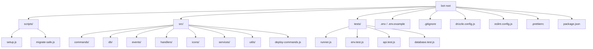

# File System Directory Structure

This file provides a directory and file lookup for the **Arcadia Community Bot** workspace.

> [!NOTE]
> `node_modules/` and `logs/` folders are ignored in this lookup structure.

## Directory & File Details

### 📂 Root Directory

- [bot.js](file:///C:/Users/kinsu/Documents/webdevkin/Arc-community-bot/bot.js): Main application entry point. Loads configuration, starts the logger, initializes DB/Redis clients, and boots up the Discord client.
- [drizzle.config.js](file:///C:/Users/kinsu/Documents/webdevkin/Arc-community-bot/drizzle.config.js): Database configurations mapping Drizzle schema generation to the MySQL server environment.
- [eslint.config.js](file:///C:/Users/kinsu/Documents/webdevkin/Arc-community-bot/eslint.config.js): ESLint static analysis configuration provided by the user.
- [.prettierrc](file:///C:/Users/kinsu/Documents/webdevkin/Arc-community-bot/.prettierrc): Settings for the Prettier formatter.
- [package.json](file:///C:/Users/kinsu/Documents/webdevkin/Arc-community-bot/package.json): Workspace script targets (`npm start`, `npm run dev`, `npm run deploy`, `npm run lint`, etc.) and dependencies listing.
- [env.test.js](file:///C:/Users/kinsu/Documents/webdevkin/Arc-community-bot/env.test.js): Environment variables, Redis connection, and database health checker script.
- [.env.example](file:///C:/Users/kinsu/Documents/webdevkin/Arc-community-bot/.env.example): Template configuration containing environment variable keys.
- [Api.enpoints.md](file:///C:/Users/kinsu/Documents/webdevkin/Arc-community-bot/Api.enpoints.md): API endpoint mapping documentation for the ArcadiaMC server.
- [fs.md](file:///C:/Users/kinsu/Documents/webdevkin/Arc-community-bot/fs.md): _(This file)_ File system reference guide.
- [GEMINI.md](file:///C:/Users/kinsu/Documents/webdevkin/Arc-community-bot/GEMINI.md): Development rule book, project context, and daily change-log repository.

### 📂 scripts/

- [scripts/setup.js](file:///C:/Users/kinsu/Documents/webdevkin/Arc-community-bot/scripts/setup.js): Assistant script to bootstrap directories and setup the `.env` template config.
- [scripts/migrate-safe.js](file:///C:/Users/kinsu/Documents/webdevkin/Arc-community-bot/scripts/migrate-safe.js): Programmatic schema migrator for Drizzle ORM.

### 📂 src/

- [src/deploy-commands.js](file:///C:/Users/kinsu/Documents/webdevkin/Arc-community-bot/src/deploy-commands.js): Slash Command deployment script utilizing the Discord REST API.
  - 📂 **src/commands/**: Contains category subfolders containing Discord Slash Commands.
    - 📂 **src/commands/general/**:
      - [src/commands/general/cstock.js](file:///C:/Users/kinsu/Documents/webdevkin/Arc-community-bot/src/commands/general/cstock.js): `/cstock` — Displays current Convoy shop stock grouped by rarity.
      - [src/commands/general/ping.js](file:///C:/Users/kinsu/Documents/webdevkin/Arc-community-bot/src/commands/general/ping.js): Ping/latency check.
  - 📂 **src/icons/**: Cache directory containing block and item texture PNG images downloaded from mcasset.cloud.
  - 📂 **src/db/**: Database schema definitions.
  - [src/db/schema.js](file:///C:/Users/kinsu/Documents/webdevkin/Arc-community-bot/src/db/schema.js): Drizzle ORM model schemas for MySQL databases.
  - [src/db/redisSchema.js](file:///C:/Users/kinsu/Documents/webdevkin/Arc-community-bot/src/db/redisSchema.js): Schema models and repositories mapping for Redis-OM.
  - 📂 **src/events/**: Discord event handlers.
  - [src/events/ready.js](file:///C:/Users/kinsu/Documents/webdevkin/Arc-community-bot/src/events/ready.js): Triggered on client login success.
  - [src/events/interactionCreate.js](file:///C:/Users/kinsu/Documents/webdevkin/Arc-community-bot/src/events/interactionCreate.js): Command execution event router.
  - [src/events/guildMemberAdd.js](file:///C:/Users/kinsu/Documents/webdevkin/Arc-community-bot/src/events/guildMemberAdd.js): Automatically runs and posts the Canvas-rendered welcome card when a user joins the server.
- 📂 **src/handlers/**: Dynamic modules loaders.
  - [src/handlers/commandHandler.js](file:///C:/Users/kinsu/Documents/webdevkin/Arc-community-bot/src/handlers/commandHandler.js): Registers and maps command files category-wise.
  - [src/handlers/eventHandler.js](file:///C:/Users/kinsu/Documents/webdevkin/Arc-community-bot/src/handlers/eventHandler.js): Imports and registers bot listeners dynamically.
- 📂 **src/services/**: Background synchronization services.
  - [src/services/convoySync.js](file:///C:/Users/kinsu/Documents/webdevkin/Arc-community-bot/src/services/convoySync.js): Synchronization worker to fetch and track convoy shop items.
- 📂 **src/utils/**: Helper modules.
  - [src/utils/apiClient.js](file:///C:/Users/kinsu/Documents/webdevkin/Arc-community-bot/src/utils/apiClient.js): Axios HTTP wrapper configured for ArcadiaMC.
  - [src/utils/canvasHelper.js](file:///C:/Users/kinsu/Documents/webdevkin/Arc-community-bot/src/utils/canvasHelper.js): Renders premium welcome cards using `@napi-rs/canvas`.
  - [src/utils/db.js](file:///C:/Users/kinsu/Documents/webdevkin/Arc-community-bot/src/utils/db.js): Drizzle ORM database instance client.
  - [src/utils/embedHelper.js](file:///C:/Users/kinsu/Documents/webdevkin/Arc-community-bot/src/utils/embedHelper.js): Central helper module to build styled, uniform Discord embeds.
  - [src/utils/errorHandler.js](file:///C:/Users/kinsu/Documents/webdevkin/Arc-community-bot/src/utils/errorHandler.js): Exception wrapper to prevent process crashes and route alerts.
  - [src/utils/iconDownloader.js](file:///C:/Users/kinsu/Documents/webdevkin/Arc-community-bot/src/utils/iconDownloader.js): Downloads missing block and item icons from assets.mcasset.cloud.
  - [src/utils/logger.js](file:///C:/Users/kinsu/Documents/webdevkin/Arc-community-bot/src/utils/logger.js): Winston/Picocolors logger.
  - [src/utils/redis.js](file:///C:/Users/kinsu/Documents/webdevkin/Arc-community-bot/src/utils/redis.js): Connection client for Redis cache operations.
  - [src/utils/redisOm.js](file:///C:/Users/kinsu/Documents/webdevkin/Arc-community-bot/src/utils/redisOm.js): Redis-OM client wrapper initialization.
- 📂 **tests/**: Codebase testing suite and validation tools.
  - [tests/runner.js](file:///C:/Users/kinsu/Documents/webdevkin/Arc-community-bot/tests/runner.js): Master test runner executing all suites sequentially.
  - [tests/env.test.js](file:///C:/Users/kinsu/Documents/webdevkin/Arc-community-bot/tests/env.test.js): Health check test for configuration, database connection pools, and Redis pings.
  - [tests/api.test.js](file:///C:/Users/kinsu/Documents/webdevkin/Arc-community-bot/tests/api.test.js): Connection verification and response validation test for the ArcadiaMC API endpoints.
  - [tests/database.test.js](file:///C:/Users/kinsu/Documents/webdevkin/Arc-community-bot/tests/database.test.js): Direct query health validation for Drizzle ORM and MySQL tables.
